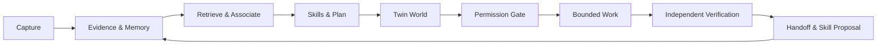

# Second Brain OS v0.2.0

**Remember what matters. Connect what seems unrelated. Turn knowledge into verifiable work.**

Second Brain OS is an **open-source, local-first cognitive workspace** for personal knowledge, persistent memory, reusable agent skills and accountable automation. Its goal is to help people capture anything, recover it with provenance, discover useful connections and delegate bounded work to agents without surrendering control over their data.

[](https://github.com/iAlirezaaa/second-brain-os/actions/workflows/ci.yml)
[](https://github.com/iAlirezaaa/second-brain-os/actions/workflows/loop.yml)
[](LICENSE)
[](VERSION)

> **Project status:** foundation plus evolving prototypes, not a finished autonomous brain. The default Python 3.9+ core uses only the standard library. Some memory, routing, actor and simulation capabilities are opt-in or under development. The CI badge shows the default branch, not a guarantee that the product is bug-free.

## What it does today

| Capability | Implemented behavior | Maturity |
| --- | --- | --- |
| Portable knowledge | Human-readable Markdown, stable numbered zones, registry records, provenance and lifecycle rules | Foundation |
| Search and recall | SQLite FTS5/keyword retrieval, imported local source records, lessons and long-term memory interfaces | Foundation |
| Agent compatibility | MCP over stdio, a central tool registry, explicit allowlists and per-tool behavior tags | Foundation |
| Task-first CLI | Private durable sessions, skills inventory, editable task list, evidence-linked completion and mandatory handoff | New, opt-in |
| Agent execution guard | Optional strict session preflight for the central toolkit and MCP; scoped writes; metadata-only event audit | New, opt-in |
| ADHD associations | Cross-domain lexical associations with original source paths, explicitly marked as hypotheses | Initial baseline |
| Twin World | In-memory task and UTF-8 file-change rehearsal, unified diffs, content hashes and protected-path refusals | Simulation only |
| Laya typed decisions | Optional local choice/score/yes-no proposals and confidence-based abstention | Adapter; model not bundled |
| Integrity and recovery | Repository health gates, CI tests and a synthetic cross-machine encrypted-backup restore test | Foundations; production recovery is separate |

**Not shipped as complete:** self-training, independent signed multi-user identity, fully isolated code-execution sandboxes, unsupervised skill promotion, real-time long-running autonomous multi-agent orchestration, production-grade cross-device sync or a proven semantic/temporal graph replacement.

## The operating loop



Every agent should look for reusable skills and create an explicit to-do list **before doing work**. Each new task stays visible. Verified outcomes become proposed improvements; promotion to trusted knowledge, canonical skills or code remains under the owner's control.

- **Master architecture:** [Product Vision](00_START_HERE/PRODUCT_VNEXT.md)
- **Accountable agents:** [Agent identities and workflows](00_START_HERE/AGENT_TEAM_VNEXT.md)
- **Engineering research:** [Open-source comparisons and adoption rules](00_START_HERE/TECH_RESEARCH_VNEXT.md)
- **Architecture and zones:** [System map](00_START_HERE/SYSTEM_MAP.md) · [Structure guide](00_START_HERE/REPO_STRUCTURE.md)
- **Engineering guardrails:** [Agent instructions](AGENTS.md) · [Security policy](SECURITY.md) · [Contributing](CONTRIBUTING.md)

## Quickstart

Prerequisites: **Python 3.9 or later** and Git. No Obsidian account, cloud model or background service is required.

On Windows (PowerShell), confirm `python --version` is 3.9 or newer before
copying the commands below. If `python` does not resolve and the optional
Python Launcher is installed, check `py -3 --version` and replace the `python`
command prefix with `py -3`. On macOS/Linux, use `python3` instead of `python`
when only that command resolves to a supported version. No specific minor
version such as 3.10 is required. Use a UTF-8 terminal for non-ASCII output.

```bash
git clone https://github.com/iAlirezaaa/second-brain-os.git
cd second-brain-os
python scripts/kb.py ingest
python scripts/kb.py search "memory"
```

### Your first local recall (no account or model)

The final two commands above create a local index and display the first
keyword matches immediately, without requiring the full maintainer test suite.

The first command builds a local index of the repository's tracked Markdown; the
second prints matching file paths and excerpts. Your index lives at `.kb/kb.sqlite`,
which is gitignored, and the commands need no network or API key. This is
**keyword-based retrieval**, not semantic memory. Symlinked Markdown files and notes reached through
symlinked directories are excluded from the index to avoid aliases crossing
knowledge boundaries. Re-run `python scripts/kb.py ingest` after updating to
remove any older aliases from your derived index. In your own installed brain,
index your notes with the same command from that brain's directory. See the
[first-session guide](skills/first-session/SKILL.md) if you are working as an agent.


The local-clone diagnostic accepts search-result Markdown paths with spaces or
square brackets; its Git-tree and SQLite/source checks still have to validate
each match. In default (offline) mode it does not test the remote GitHub download
or guarantee first-use latency.

For a **local Git-clone-to-first-hit diagnostic**, run
`python scripts/clean_checkout_recall.py` from a Git checkout. It makes a
disposable no-hardlinks clone of committed files, runs the real offline
ingest/search commands, checks that SQLite contains the reported source hits **and** that each indexed title/body substantiates the `memory` keyword, and independently checks that the committed Markdown text or source filename contains that keyword,
and prints failure-aware JSON with clone, index, search and total time. It
also cross-checks the indexed title, full body and normalized body against the
committed source; a fabricated SQLite row is not source-backed recall evidence. This
**includes local Git clone time but excludes GitHub/network download, Python
installation, human editing and personal note ingestion**. It does not yet
establish five-minute end-to-end onboarding; independent full-path platform
timings are still needed. This probe is under review, not released. The draft CI workflow is
configured to run the same disposable local-clone probe in all four
Ubuntu/Windows Python 3.9/3.12 jobs and the focused macOS 15 job; only
completed exact-commit runs provide evidence. None measures network download.

The diagnostic also validates **every** SQLite `notes` row against its
committed Markdown source, not just returned keyword hits: a plausible,
unreported row with a tracked path but fabricated content fails with
`indexed_source_mismatch` (the untrusted path is not printed). This
extra verification is included in measured total time. To avoid a false
failure while the existing KB still indexes committed operational Markdown,
integrity-only comparisons may read those files **inside the disposable public
clone**; they do not authorize restricted search hits, read a personal home
or provide an OS sandbox. Privacy isolation of the runtime KB remains tracked
separately in issue #140 / PR #141.

The diagnostic snapshots the committed Git tree **before ingest**. A path
created by the indexing process (even if its Markdown, SQLite row and printed
hit agree) is **not** a committed-source hit and fails with
`no_source_backed_hit`. An unavailable Git tree is reported as
`tracked_paths_unavailable`. The HEAD-tree enumeration counts toward `clone_ms`,
not `preflight_ms`. This is a check on benchmark evidence only, not
on production note creation or a security sandbox.

The draft local-clone diagnostic also refuses symlinked executable or
SQLite-cache paths (`scripts/`, `scripts/kb.py`, `.kb/`, `.kb/kb.sqlite`)
with `unsafe_checkout_path` before launching the indexer and before
checking index results. This prevents following obvious linked paths outside
the disposable clone; it is **not** an OS-level execution sandbox.
Reported Markdown hits are also rejected when their source path traverses a
symlink or directory junction, **even if the target is inside the checkout**:
a public-looking `02_WIKI/` alias must never validate text from the denied
`09_OPERATIONS/` plane. This is a fail-closed diagnostic witness, not a
claim that the operating system prevents a malicious local process.
The SQLite row/source comparator also independently applies this public-plane
path check; checking only the keyword first cannot authorize a later read of
restricted or linked Markdown. These checks are not atomic against filesystem
races and do not constitute a sandbox. This draft change is not released.


**Clean-source requirement:** the diagnostic refuses staged changes, modified
tracked files and nonignored untracked files with `source_dirty` rather than
silently cloning the last commit and ignoring those edits. Commit the work or
run from a clean worktree before comparing results. Gitignored local indexes
(e.g. `.kb/`) do not make the source dirty. JSON reports `preflight_ms`
separately; `clone_ms` now excludes the Git-status check, while total elapsed
time includes it. An unreadable/non-Git source returns
`source_status_unavailable`. This is a benchmark integrity guard, not a
backup, recovery or protection of user data. It is proposed in PR #145.

For a **repeatability check** on independent temporary clones, use
`python scripts/clean_checkout_recall.py --repeat 3` (1–5 trials; default 1).
JSON includes each trial's outcome, successful-trial count, success rate,
the checked-out **Git commit SHA** (also in each trial), median wall time
**including failures**, and maximum trial time. If the source branch advances
between trials, the aggregate refuses to label mixed revisions a successful
repeatability sample. The added Git revision lookup is counted in clone time.
Any failed
trial gives a nonzero exit. This is still an **offline local-clone diagnostic**,
not a measure of network download, first-time Python setup, user adoption or
a guarantee of a five-minute first session. The multi-trial option is proposed
in PR #145, not released.

In the proposed CI, the four Windows/Ubuntu configurations and focused macOS
job each run **three independent local Git clones** (`--repeat 3`), failing
if any sample cannot return a source-backed keyword hit. The JSON retains
all trials rather than cherry-picking one fast result. Remote download,
Python setup and real-user time-to-first-result remain unknown; PR #145
is not merged.

### Optional public GitHub download-to-first-recall diagnostic (in review)

The witness also checks **every SQLite-indexed source path** against the
cloned commit, not just the keyword hits shown on screen. If an index includes
an uncommitted or invented path, it fails with `uncommitted_index_path`
instead of certifying a misleading successful recall. This is an integrity
check, not a full security/access-control audit; protected-zone exclusions
are tracked separately in issue #140.

`python scripts/clean_checkout_recall.py --github --repeat 3` opts in to
a real **HTTPS clone from this project's fixed public GitHub URL**, followed
by the same committed-tree, SQLite and Markdown checks as the offline probe.
JSON separates `transport: git_remote`, the exact downloaded `commit_sha`,
network-inclusive `clone_ms`, total elapsed time, successful trials and failures.
No arbitrary repository URL can be passed on the command line. Git credential
helpers, terminal prompts and user/system Git configuration are disabled in
this mode. Each trial gives Git and the downloaded indexer a disposable
`HOME` and `USERPROFILE` (plus matching Windows home-drive variables), and
`TMP`, `TEMP` and `TMPDIR` point to a separate, existing disposable temp directory.
This avoids passing the caller's home or scratch paths through those environment
variables to downloaded Python. It is **not** an OS sandbox.
Downloaded Python still has the caller's filesystem and network privileges
and may discover files through other means. Run only trusted source code.
Before launching the indexer, the probe also checks that `scripts/kb.py`
belongs to cloned HEAD and is unchanged after checkout. It refuses with
`kb_not_committed` or `kb_checkout_modified` otherwise. This checks
benchmark provenance, **not** whether committed third-party code is safe.
After ingest and search, the diagnostic also uses `git diff HEAD` to
reject **any tracked file changed during the trial** with
`tracked_checkout_modified`. Without this check, an indexer could rewrite
a committed note and make SQLite agree with the *rewritten* text, producing
a false claim of recall from unmodified HEAD. Generated `.kb/` cache files
remain allowed. This is a benchmark-integrity check, not a sandbox.

A failed HTTPS clone reports `remote_clone_failed` (rather than the offline
`local_clone_failed`) and preserves the attempted `clone_ms`; a clone
timeout reports `timeout` and `timeout_phase: "clone"` with the same timing.
If Git transferred the checkout but HEAD verification or tracked-tree enumeration
fails (or times out), the failed attempt still has a numeric `clone_ms` rather
than `null`; this is not a successful first-recall duration.
Later timeouts identify `ingest`, `search` or `validation` in `timeout_phase`
(`preflight` for a local source check); successful trials return `null`.
Failed trials never substitute
a local clone or include raw Git stderr in JSON. These timings are attempted
transfer duration, **not** successful first-use measurements.

The default command (without `--github`) remains network-free. CI tests
the alternate Git transfer path via a local `file://` transport and does
**not** claim to benchmark real GitHub HTTPS latency. The optional mode
does not time Python installation, user typing or editor setup; independent
Windows/macOS/Linux HTTPS measurements with observed failures are still
needed before claiming a five-minute first use. This is a **Draft PR #145**
feature tracked by issue #147, not a released capability.

### Put personal knowledge in a separate local brain (optional)

The first search above explores this repository's documentation, **not your
personal memory**. To make a local home for your own Markdown, choose a new,
empty directory *outside* this public source checkout:

```bash
python scripts/install.py --target ../my-private-brain
cd ../my-private-brain
```

In that new directory, use a local editor to create
`02_WIKI/my-first-note.md` containing an original, non-sensitive test
sentence with the exact word `YOUR_UNIQUE_TERM`. Then run:

```bash
python scripts/kb.py ingest
python scripts/kb.py search "YOUR_UNIQUE_TERM"
```

Confirm that the result names `02_WIKI/my-first-note.md`. The installer
refuses a nonempty destination; it does not overwrite an existing brain.
This separate folder is **not inside the cloned project's Git repository**,
but you must still check whether a parent directory is synced or tracked
before entering any private information. A local folder is not encryption
or an OS-enforced permission boundary. Never commit or publish private
notes or credentials. This is a separate personal-home walkthrough, **not**
a measured clean-clone timing or evidence of multi-host compatibility.

### Full repository checks (for contributors)

After your first search, return to the **source checkout** before running its
health gates and complete test suite. This matters if you followed the optional
private-home installation above: that installed home ships only its own
installed-home test, not the complete repository suite. Run these checks
**before proposing code changes**:

```bash
cd ../second-brain-os
python scripts/health.py
python -m unittest discover -s tests
```

These may take longer than a first search. They are contributor verification
steps, not prerequisites for using the offline keyword index. The total
clone-to-first-result time has not been independently measured on all target
platforms.

To verify this path independently on **synthetic** notes (no private data), run:

```bash
python scripts/first_success.py --repeat 3
```

This bounded, offline smoke probe creates disposable Markdown, invokes the real
`kb.py ingest` and `kb.py search` commands, and prints JSON containing observed
success rate and per-trial/median latency. It exits nonzero on any failed
trial and cleans up its temporary index. **It does not measure Git clone,
installation, full first-use time, semantic recall or real-user performance.**
The under-five-minute end-to-end onboarding goal remains unverified. A dedicated macOS 15/Python 3.12 CI job exercises the disposable installed-home path and both focused first-recall/onboarding test modules (including bilingual command-order and synthetic environment-canary checks). This is not the full macOS suite, real-user support certification or clone timing.

To measure the optional **installed personal home** path separately, without
using private notes, run `python scripts/first_success.py --installed-home --repeat 1`
from the source checkout. Its JSON covers local install, synthetic note creation,
indexing and keyword retrieval, checks the cited path and verifies the
actual SQLite source rows and declared index count. The measured interval now includes
SQLite validation and treats verification that exceeds the trial deadline as a
timeout, rather than a successful fast recall; SQLite lock waiting is limited
by the remaining deadline (not a hard filesystem time limit). It excludes
Git clone and editor time. Ubuntu/Windows matrix jobs and a dedicated
macOS 15/Python 3.12 job run this synthetic installed-home probe; pass/fail
and measured latencies describe those runners, not user hardware. The wider
macOS onboarding assertions are pending fresh exact-head CI verification.
The installed-home synthetic installer and KB subprocesses now receive a
minimal process environment, not the shell's unrelated API keys or `PYTHONPATH`.
This is **not** an OS sandbox, permission boundary, or verified host integration;
the default first-recall probe has a separate pending fix in PR #134.
See [first-success acceptance criteria](https://github.com/iAlirezaaa/second-brain-os/issues/93).

Use the CLI to discover skills, open an accountable session and monitor it:

```bash
python scripts/brain.py --help
python scripts/brain.py skills --query "research"
python scripts/brain.py start --goal "Research an idea and retain reliable sources"
# Replace SESSION_ID with the SES-... identifier returned above:
python scripts/brain.py status SESSION_ID
python scripts/brain.py add SESSION_ID --task "Independently verify key findings"
python scripts/brain.py trace SESSION_ID
```

A successful close requires completed tasks, inspected evidence, a fresh handoff and explicit human confirmation. Ending a session creates a **draft** skill proposal, never an automatically trusted executable skill.

Start the MCP server for compatible agent hosts:

```bash
python 15_SYSTEM/scripts/mcp_server.py
```

For Claude Desktop, OpenCode V2 or Codex CLI, generate a machine-local config snippet instead
of copying someone else's filesystem path:

```bash
python scripts/mcp_config.py --client claude-desktop
python scripts/mcp_config.py --client opencode
python scripts/mcp_config.py --client codex
```

Claude/OpenCode output JSON; Codex output is TOML (`[mcp_servers.second-brain]`
with `enabled = false`). Manually merge the appropriate entry into your
host config without replacing existing servers. Codex config is typically
`~/.codex/config.toml`; inspect the Codex permissions and manually enable only
after review. **OpenCode V2** uses `mcp.servers.second-brain`; its generated
entry starts `disabled: true` because the server offers write-capable tools.
Only enable it after reviewing tool permissions. These commands do not connect
a host or grant tools permission. The MCP server
offers write tools as well as reads, so review the host's tool approvals and
privacy boundary before connecting. [Integration instructions and limitations](15_SYSTEM/integrations/README.md).

To verify the **real local stdio server**, without connecting a host or
loading private notes, run `python scripts/mcp_smoke.py`. It performs a
synthetic source-cited search and checks that strict session mode rejects an
unapproved write; a JSON report records the outcome. This is not external
Claude/Codex/OpenCode compatibility or an OS sandbox test.

For **strict session enforcement** on central toolkit/MCP calls, opt in with the process environment variable `SBO_REQUIRE_SESSION=1`, then provide registered actor/session metadata on calls. This is a local coordination boundary, **not** cryptographic authentication. See the [complete CLI guide](00_START_HERE/CLI_VNEXT.md) before enabling strict mode.

### Working with knowledge and private sources

```bash
python scripts/kb.py --help
python scripts/sources.py --help
python scripts/memory.py --help
```

Local source importing and searching are documented in [Source ingestion](15_SYSTEM/integrations/local-sources.md). Imported private data is kept out of Git by default. Do not upload personal records, credentials, local database files or model checkpoints to public repositories.

### Optional local Laya decision engine

The core runs without PyTorch or Laya. For a separate Python 3.10+ environment, read [Laya installation](15_SYSTEM/integrations/laya.md) and [optional dependencies](requirements-laya.txt). This adapter only **proposes** classifications; it does not run tools or authorize actions. Model weights and model-specific benchmarks are not provided.

### Simulate before applying changes

```bash
python scripts/brain.py twin-files --plan /path/to/changes.json
```

Twin World 1a creates an in-memory overlay and reports a bounded diff. **It does not run untrusted code and is not a VM/container sandbox.**

## Repository organization

| Location | Responsibility |
| --- | --- |
| `00_START_HERE/` | Product documentation, governance, onboarding |
| `01_INBOX/`–`10_ARCHIVE/` | Human-owned knowledge, projects, creative work and archive |
| `11_CONTROL/` | Agent, skill, schedule and policy registry |
| `12_RUNTIME/`, `13_LAB/` | Local-only runtime/experimental planes; intentionally not committed |
| `14_CANDIDATES/` | Reviewable proposed improvements, separate from trusted knowledge |
| `15_SYSTEM/` | Engine internals, memory schemas and integrations |
| `scripts/` | Human-invoked CLI and governance commands |
| `skills/` | Reusable SKILL.md procedures with metadata-first discovery |
| `tests/` | Offline regression and compatibility suites |
| `rules/`, `vault-template/` | Machine-checked contracts and optional notebook template |

**Placement policy:** do not move `scripts/`, `15_SYSTEM/scripts/`, `11_CONTROL/` or numbered zones merely for aesthetics. The architecture has path-based registries, permission boundaries and tests. Structural migrations require a reference audit, compatibility redirects where appropriate, reproducible tests and a rollback plan.

## Engineering and quality

The CI workflow validates Python 3.9 and 3.12 on Ubuntu and Windows, runs health gates, unit tests, the HADES fresh-clone battery and synthetic cross-host recovery checks. Superseded PR commits are cancelled to reduce queue noise. The nightly improvement loop should publish a reviewable report branch instead of attempting to push through `main` protection.

A green CI result is an important **minimum**, not a product-completeness score. Report problems through [GitHub Issues](https://github.com/iAlirezaaa/second-brain-os/issues), and keep verified fixes attached to regression tests. See [Roadmap](ROADMAP.md) and [Issue ledger](00_START_HERE/ISSUES.md).

### Reproducible repository measurements

This table is regenerated by `python scripts/doc_report.py --write`. A failed measurement or duplicate measured block must fail closed.

<!-- BEGIN measured — written by `python scripts/doc_report.py --write` -->
| measure | now |
| --- | --- |
| tests collected (`python -m unittest discover -s tests`) | 1126 |
| health gates (`python scripts/health.py`) | 17 |
| registry records (`11_CONTROL/**/*.json`) | 20 |
| skills in the pack (`skills/*/SKILL.md`) | 14 |
| agent-host doors (`python scripts/sync_hosts.py --list`) | 5 |
| active lessons (`15_SYSTEM/memory/lessons.jsonl`) | 27 |
| candidate rows on the shelf (`14_CANDIDATES/loop`) | 6 |
| kinds in the contract (`15_SYSTEM/config/system.json`) | 34 |
| relation types in the contract | 13 |
| zones a fresh clone reproduces / declared (`12_RUNTIME`, `13_LAB` are gitignored) | 12 / 16 |
| python floor | 3.9 (standard library only) |
<!-- END measured -->

## License and translations

Distributed under the [MIT License](LICENSE). See [Contributing](CONTRIBUTING.md), [Code of Conduct](CODE_OF_CONDUCT.md) and [Security](SECURITY.md).

**Persian documentation:** [Persian-language guide](00_START_HERE/README_FA.md).
